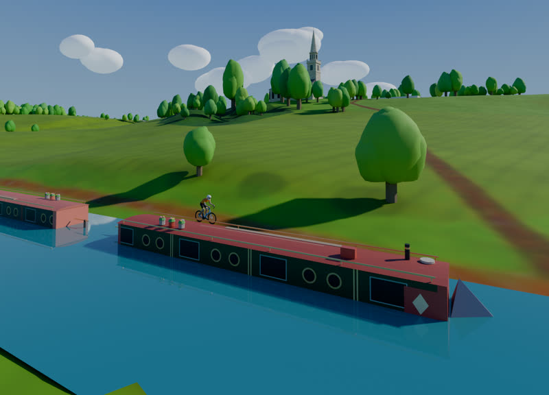
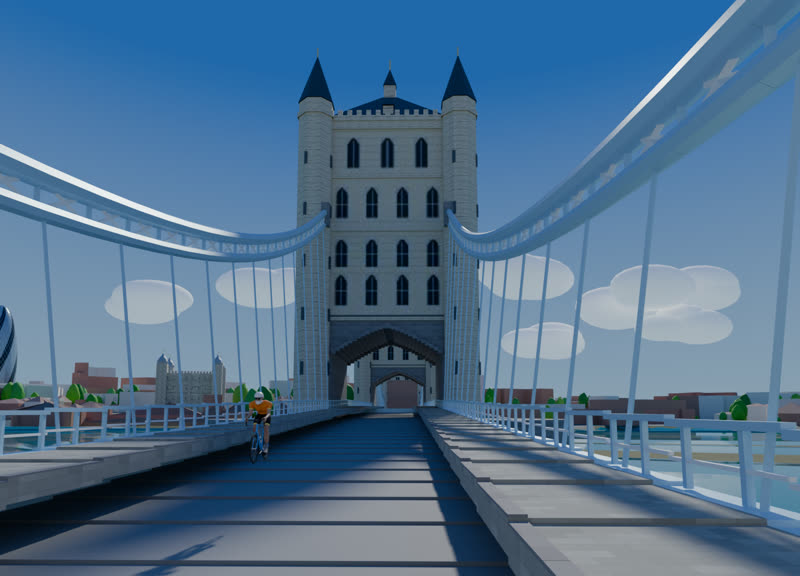
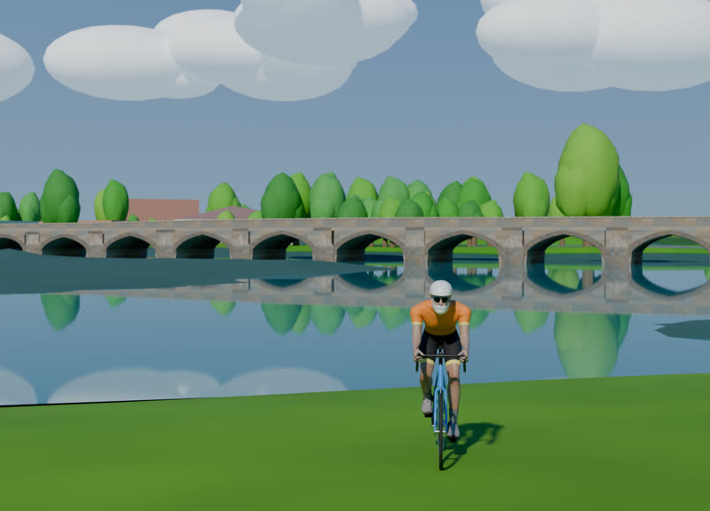

# RideWorld

Indoor cycling on real roads, in your browser. Connect your smart trainer and heart-rate strap, pick a route anywhere in
the world (Google's photorealistic 3D cities and mountains) or ride free in a hand-built open world, and your own power
moves you along it. Ride with friends on the same server, chase pacers and your own ghosts, follow structured workouts,
and upload to Strava.

| Bromsgrove | London | Stratford-upon-Avon |
|---|---|---|
|  |  |  |

## What it does

- **Routes on real roads**: import any GPX / TCX / FIT / KML, or plan one on the map. Scenery from Google Photorealistic
  3D Tiles (your own key) with a clean drawn road, tunnels, bridges and corrected heights.
- **Open worlds**: ride-anywhere maps built from OpenStreetMap and laser-survey (LIDAR) heights, with stylised buildings,
  trees, canals, locks and landmark models. Choose your way at every junction, use the satnav, or follow a pre-plotted ride.
- **Your power, real physics**: speed comes from your watts, weight and the gradient; the trainer's resistance follows the
  road (ANT+ FE-C or Bluetooth FTMS), or ERG mode for workouts.
- **Sensors**: ANT+ USB stick (WebUSB) or Bluetooth (Web Bluetooth): trainers, power meters, heart-rate straps, cadence.
- **Together**: everyone on the server rides in the same world; group rides with a shared start, drafting, banding.
- **Training**: built-in and imported Zwift (.zwo) workouts, pacers, ghosts of your best ride, segments with leaderboards.
- **Phone remote**: steer, change camera, pause and take photos from your phone.
- **Rides**: saved per account, .fit / .tcx / .gpx downloads, Strava upload, shareable photo pages.
- **Apps** (optional): a Windows app (Electron) and an Android app (WebView with native Bluetooth) in `apps/`.

## Quick start

You need a computer to run the server (Linux, macOS, Windows with WSL, a Raspberry Pi 4/5, a NAS with Docker), and a
browser to ride in: **Chrome or Edge** on a PC or Mac (Android Chrome works too). iPhones and iPads have no Web Bluetooth.

### With Docker (easiest)

```sh
git clone <this repository> rideworld && cd rideworld
cp .env.example .env          # optional: change the port, or set HOST_IP to this computer's LAN address
docker compose up -d
docker compose logs rideworld # shows the admin account's password
```

### Without Docker

Node.js 20 or newer, nothing else (there are no npm dependencies):

```sh
git clone <this repository> rideworld && cd rideworld
./setup.sh                    # certificate, data folder, first admin account
./start.sh                    # or ./setup.sh --service to run it as a systemd service
```

Then open **https://&lt;server address&gt;:8443**, accept the certificate warning once (the server makes its own; install
[mkcert](https://github.com/FiloSottile/mkcert) before `./setup.sh` to avoid it), and sign in as admin.

### First steps in the app

1. **Keys** (admin, the 🔑 button): a **Google Maps Platform API key** with the *Map Tiles API* enabled gives the
   photorealistic 3D scenery for routes ([how to get one](https://developers.google.com/maps/documentation/tile/get-api-key));
   restrict it to your server's address. Open worlds don't need it. A free [Cesium ion](https://ion.cesium.com) token is
   the fallback scenery without a Google key.
2. **Accounts**: add the other riders (or turn on registration under Accounts → Email).
3. **Sensors**: *Add a Bluetooth device*, or plug in an ANT+ USB stick and press *ANT+ stick*. On Windows the stick needs
   the WinUSB driver for the browser to see it ([Zadig](https://zadig.akeo.ie); the app has a how-to video), or use the
   Windows app.
4. **Open worlds**: install a ready-built one:

   ```sh
   tools/get-world.sh                     # lists them
   tools/get-world.sh bromsgrove-open     # or london-central, stratford-alcester
   ```

5. Pick a route or world and **Go ride** (or **Simulator** to try it without a trainer: ↑ / ↓ set the power).

## Riding from outside your home network

Put it behind a reverse proxy with a real certificate (Caddy, Nginx Proxy Manager, Traefik) and set `PUBLIC_URL` in `.env`.
The phone remote, Strava and registration emails then work from anywhere. Set up Strava (an API application of your own)
and email (a Brevo account) in the app as admin.

## Building your own open world

See [docs/BUILDING-WORLDS.md](docs/BUILDING-WORLDS.md). In short: an OpenStreetMap extract of the area, laser-survey
heights (the Environment Agency's free LIDAR covers England; elsewhere another DTM / DSM source is needed), and Node.
Landmark models are built with Blender scripts in `tools/kit/`.

## Data, licences, thanks

- Map data © [OpenStreetMap](https://www.openstreetmap.org/copyright) contributors (ODbL); the open-world packs are
  derived from it and are shared under the ODbL.
- Heights: Environment Agency LIDAR, © Environment Agency copyright and/or database right, Open Government Licence v3.0.
- 3D scenery: Google Photorealistic 3D Tiles, under Google's terms, with your own key; Cesium / CesiumJS (Apache 2.0).
- Leaflet (BSD 2), flag-icons (MIT), Barlow and Inter fonts (SIL Open Font Licence), the rider from MakeHuman / MPFB2
  assets (CC0). See [NOTICE.md](NOTICE.md).
- The code: [GNU Affero General Public License v3.0 or later](LICENSE). In short: use it, change it, run it for
  others; if you run a changed version as a service people use over a network, share your changes under the same licence.
